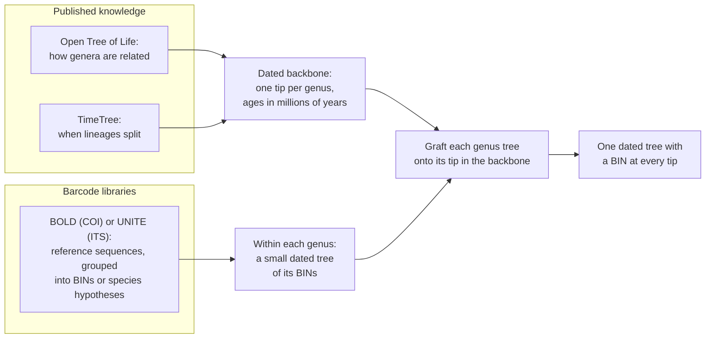
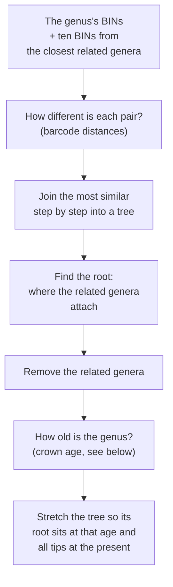
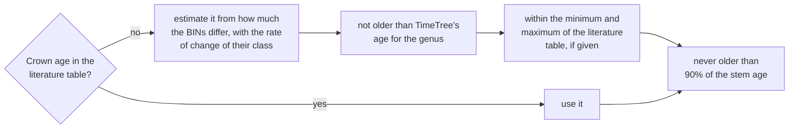
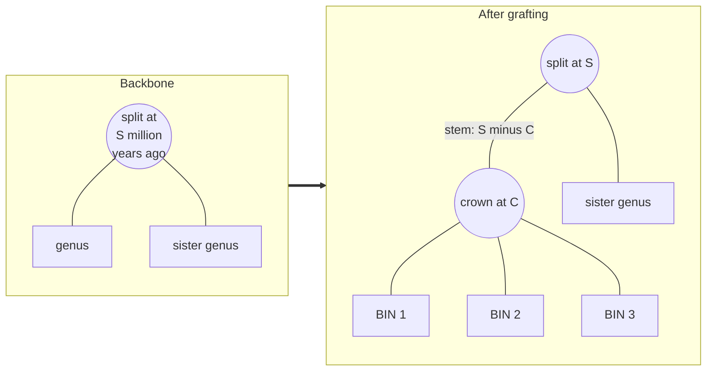
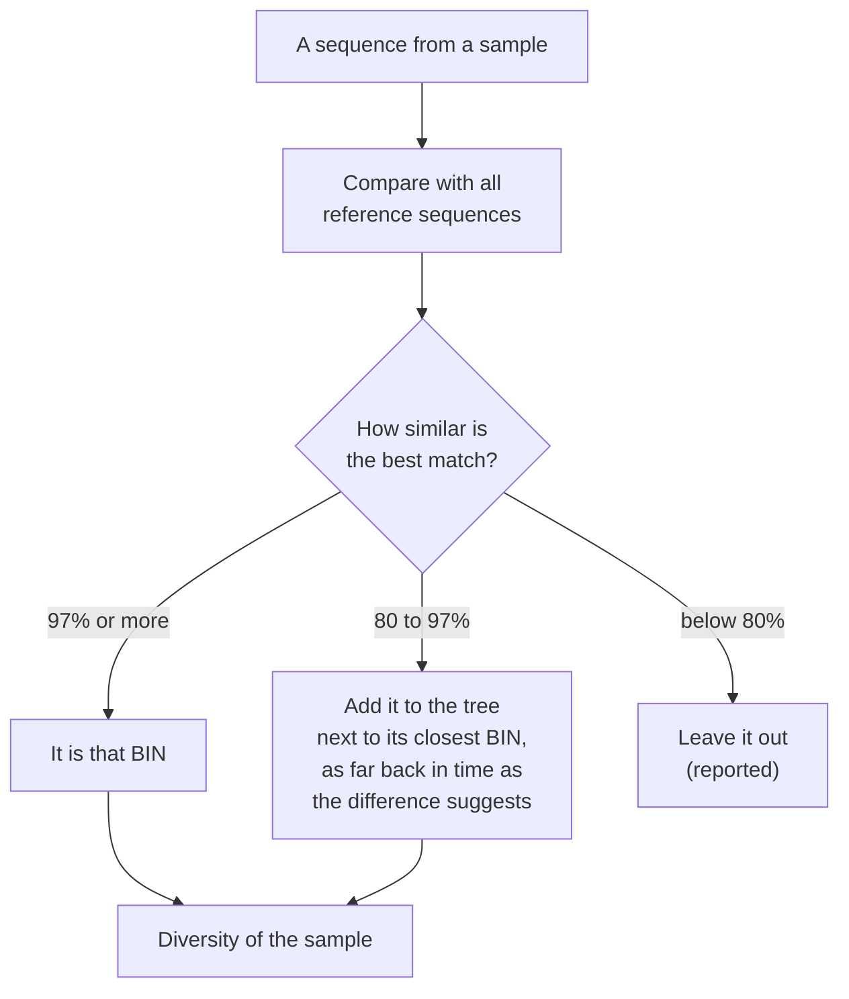

# How timegraft works

This page explains the method without code. For settings and commands, see the [technical documentation](../technical/configuration.md).

## The problem in one paragraph

Metabarcoding tells us which organisms are in a sample. To measure how much evolutionary history a sample holds, or how different two samples are, we need a tree that connects those organisms and whose branch lengths mean something, ideally time. DNA barcodes are short (about 650 bases for COI, a few hundred for ITS). They are good at telling close relatives apart, but they lose track of how far apart distant groups are: after enough time, mutations pile up on the same positions and the differences stop growing (saturation). Older approaches tried to build the whole tree from barcodes anyway, and failed at the deep end.

## The idea: let each source do what it is good at

- **Above genus level**, the tree comes from published knowledge: the branching order from the Open Tree of Life, which synthesises thousands of published phylogenies, and the ages of the branching points from TimeTree, which synthesises published divergence times.
- **Within each genus**, the barcodes decide: which BINs are most closely related, and how long ago they split. This is the range in which barcodes are reliable.
- **Grafting** joins the two: each genus tip in the backbone is replaced by the genus's own small tree.

Because everything is expressed in millions of years, the pieces fit together without any rescaling, and a tree for COI and a tree for ITS measure diversity in the same unit.

## Step 1: reference units

Barcode libraries hold many sequences per species. BOLD groups them into BINs, clusters that correspond roughly to species; UNITE does the same for fungi with species hypotheses. timegraft keeps one representative sequence per BIN (the one most similar to the others), after removing sequences that are too short, too ambiguous, or that cannot be read as a protein-coding gene. Each BIN is assigned to the genus that most of its records are identified as.

## Step 2: the dated backbone

The backbone is a tree of genera with known ages:

1. All genera in the data are looked up in the Open Tree of Life, which gives how they are related.
2. For each branching point, TimeTree is asked when the lineages on either side split. TimeTree does not know every genus, so it is also asked about species within the genera and, as a last resort, about the families or orders they belong to.
3. Branching points that TimeTree cannot date are given ages evenly spread between the nearest dated points above and below.

Each genus in the backbone then has a **stem age**: when it split from its closest relatives.

## Step 3: a small tree per genus

A genus and its relatives are rarely separated perfectly by barcodes: a few BINs of the genus may fall among the related genera, or the other way round. The root is therefore put where the fewest BINs are on the wrong side; BINs of the genus that end up among the relatives stay in the tree as its earliest branches and are listed in the provenance, as some of them will be misidentified. When several places are equally good, the one that makes the genus tree most clock-like decides (minimal ancestor deviation, which is also used when there are no relatives to root with). Because the root is often uncertain, the provenance also says, per genus, how many other places are nearly as good, and how much the crown age and the genus's PD would change if the root were put there or if the genus's BINs among the relatives were left out.

The **crown age** is when the living members of the genus last shared an ancestor. Barcodes alone cannot give it: they say how much the BINs of a genus differ, not how long that took. The crown age is therefore an estimate from the barcodes, kept within limits from outside sources:

- **The rate of change differs between groups.** Fishes change more slowly than most invertebrates, and sharks more slowly still. The rate is therefore set per class, calibrated on the genera whose crown age is known, with one pooled value for classes without enough such genera.
- **TimeTree's age for a genus is a limit, not the answer.** It is the age of the common ancestor of all species TimeTree knows under the genus name. For a natural group that is about right. For a genus that is not a natural group it spans a much older split, and gave crown ages of hundreds of millions of years. Used as an upper limit, a good TimeTree age keeps the estimate in check and an inflated one does no harm.
- **No thresholds.** An earlier version used TimeTree's age outright unless it was more than three times the barcode estimate. A small change in the data could then move a crown age by a factor of three. With limits, a small change in the data gives a small change in the age.

Below the crown, the tree is stretched so that its root sits at the crown age and all tips at the present, assuming that the BINs of a genus change at about the same rate (mean path length, or LSD2). Methods that let the rate vary over the tree (penalised likelihood) were tested and are available, but are not the default: within a genus they gave nearly the same branch lengths, and they cannot estimate the crown age itself. The [dating results](results/2026-11-dating.md) give the evidence.

## Step 4: grafting

The genus tip is replaced by a stem of length S − C (stem age minus crown age), followed by the genus tree, whose tips all end at the present. Every genus is handled independently, so the work runs in parallel and scales to tens of thousands of BINs.

## Step 5: samples

With every sequence of a sample on the tree, diversity follows directly:

- **Faith's phylogenetic diversity**: the total length of the branches that connect a sample's organisms, in millions of years of evolutionary history.
- **Mean pairwise distance**: how long ago, on average, two organisms in the sample shared an ancestor.
- **UniFrac and PhyloSor**: how much of their branch length two samples share.

## Step 6: checking where barcodes stop being reliable

The method relies on barcodes being informative within genera. That can be checked: take pairs of BINs at increasing taxonomic distance (same genus, same family, same order), compare their barcode difference with their distance in a trusted tree built from other data, and see where the barcode difference stops growing. This is built into timegraft as a validation step, and it is the subject of planned work per animal phylum.

## What comes out

A dated tree with a BIN (or species hypothesis) at every tip, diversity values per sample and per pair of samples, and tables that record, for every genus and every branching point, where its age came from: TimeTree, a family-level stand-in, interpolation, the barcodes with the rate that was used and any limit that was applied, or a literature value. That record matters, because the ages are only as good as their sources; see [assumptions and limitations](limitations.md).
