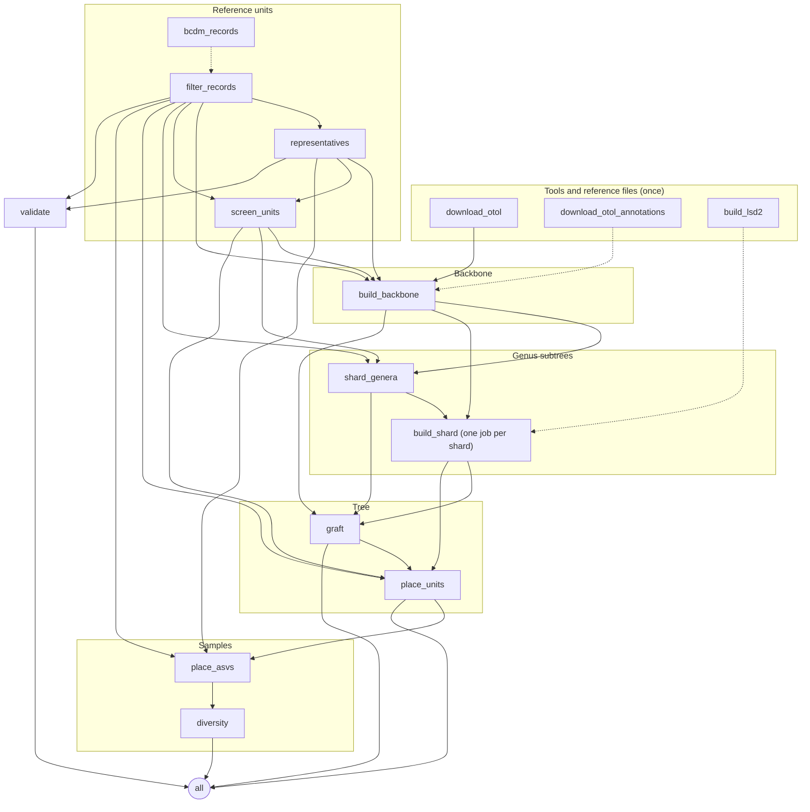

# Running timegraft and its outputs

## Running

```bash
snakemake --cores 4 --use-conda                                   # toy example
snakemake --cores 8 --use-conda --configfile config/config.yaml my_run.yaml
snakemake -n --configfile config/config.yaml my_run.yaml          # dry run: what would be done
```

## Preparing BOLD data

`timegraft.bcdm` also runs on its own, which is the practical way to cut a subset out of a full BOLD data package:

```bash
# 1. which genera occur in the region
python -m timegraft.bcdm BOLD.parquet regional.tsv \
    --taxon phylum=Annelida,Mollusca,Arthropoda,Echinodermata,Cnidaria,Bryozoa,Porifera \
    --exclude class=Insecta,Arachnida,Collembola,Diplopoda,Chilopoda \
    --country Portugal,Spain
cut -f3 regional.tsv | tail -n +2 | grep -v '^$' | sort -u > genera.txt

# 2. all BINs of those genera, worldwide, at most ten records per BIN
python -m timegraft.bcdm BOLD.parquet records.tsv --taxon genus=@genera.txt --max-per-unit 10
```

`rank=@file` reads names from a file, one per line. A list of genera from the samples themselves is a better filter than a country, as a regional BOLD subset also holds terrestrial and freshwater taxa.

### The Iberian run

The run in [the first results](../science/results/2026-11-iberia.md) used the BOLD public data package of 27 March 2026 and `config/iberia.yaml`. The records, the TimeTree answers and the outputs are in `data/iberia/` (see its README to rebuild the run without the data package); to cut the records yourself:

```bash
python -m timegraft.bcdm BOLD_Public.27-Mar-2026.parquet regional.tsv \
    --taxon phylum=Annelida,Mollusca,Arthropoda,Echinodermata,Cnidaria,Bryozoa,Porifera,Chordata \
    --exclude class=Insecta,Arachnida,Collembola,Diplopoda,Chilopoda,Amphibia,Reptilia,Aves,Mammalia \
    --country Portugal,Spain
cut -f3 regional.tsv | tail -n +2 | grep -v '^$' | sort -u > genera.txt
mkdir -p resources/iberia
python -m timegraft.bcdm BOLD_Public.27-Mar-2026.parquet resources/iberia/records.tsv \
    --taxon genus=@genera.txt --max-per-unit 10
snakemake --cores 8 --use-conda --configfile config/config.yaml config/iberia.yaml
```

## The workflow

Which rules run depends on the configuration: the backbone is either read or built, LSD2 is only built when selected, and placement, diversity and validation only run when their inputs are given. With everything switched on:



Dashed arrows are optional: `bcdm_records` only runs when `bcdm.path` is set, `build_lsd2` only with `dating.method: lsd2`, `download_otol_annotations` only with `backbone_build.synthesis_support`. The backbone reads the screening (the nearest units of other genera are one of its placement checks), and `place_units` reads the units that genus subtrees left out for a long branch (`subtrees/set_aside_<shard>.tsv`). With `dating.method: chronos` the genus subtrees are built in an environment that also holds R and ape. To draw the graph for your own configuration:

```bash
snakemake --configfile config/config.yaml my_run.yaml --rulegraph mermaid-js
```

## Outputs

All under `outdir`.

| File | Content |
| --- | --- |
| `timegraft.tre` | The dated tree; tips are unit ids |
| `backbone/backbone.tre` | The dated backbone, one tip per genus (when built; otherwise the `backbone` input is used) |
| `grafted.tre` | The same, before units without a genus were placed |
| `provenance.tsv` | Per backbone genus: subtree, single unit or pruned; stem and crown age; where the crown age came from (`crown_source`), the bounds it lies between (`crown_lower`, `crown_upper`, `crown_upper_source`), the age from the barcodes before any bound (`barcode_age`), the TimeTree value (`timetree_crown`) with the species it is the crown of (`crown_basis`), its plausibility against the barcodes (`crown_plausibility`, `timetree_ratio`, `ratio_allowed`) and the decision in words (`crown_decision`; [#54](https://github.com/naturalis/timegraft/issues/54)), the mean root-to-tip distance of the rooted genus tree (`root_to_tip`) and the units far beyond it with what was done with them (`rate_outliers`, `rate_outlier_z`, `rate_outlier_action`; [#55](https://github.com/naturalis/timegraft/issues/55)) and the substitution rate with its source (`rate`, `rate_source`); rooting method, number of units on the wrong side of the root and the genus's units among the outgroup (`violations`, `misplaced`); how uncertain the root is and what that does to the ages (see below); dating method; outgroup |
| `backbone/genera.tsv` | How each genus was matched in OTT and placed in the synthesis; the ids OTT holds for it, its OTT lineage and that of its reference records, and the clade it is anchored at ([provenance](provenance.md)) |
| `backbone/node_ages.tsv` | Per backbone node: age, its source, TimeTree's raw answer, the NCBI ids queried, and a conflict ratio; the evidence behind TimeTree's age (estimates, studies, interval, the node it dated) and the support of the node in the synthesis ([provenance](provenance.md)) |
| `backbone/crown_ages.tsv` | TimeTree crown age estimates of the species sampled in the run (or of the whole genus where that is not possible), with the species queried, both answers and TimeTree's evidence ([provenance](provenance.md#crown-ages-from-the-sampled-species)) |
| `backbone/col_species.tsv` | With `backbone_build.col.species`: each species name of the records resolved in the Catalogue of Life, with its NCBI id ([provenance](provenance.md#catalogue-of-life-as-identifier-hub)) |
| `backbone/concordance.tsv` | Per genus: three independent checks of its placement in OToL (reference lineage, merged NCBI ids, barcode neighbours) and a flag where two fail, sorted for review, with what was done about it ([provenance](provenance.md#placement-concordance)); flagged genera are moved before dating ([re-anchoring](provenance.md#re-anchoring-flagged-genera)) |
| `backbone/metadata.json` | Releases the backbone was built from, the format version of each output and of the TimeTree cache, and a summary of the TimeTree evidence |
| `units/rejected.tsv` | Records rejected by the filter, with the reason |
| `units/representatives.tsv`, `units/unassigned.tsv` | One representative per unit; units without a usable genus |
| `units/screened.tsv` | Per unit: the screening decision (`keep`, `other_genus`, `isolated`, `numt_like`, `kept_whole_genus`, or `not_screened` with screening off), its nearest unit of the same genus and of another genus with their identities and where they came from, the thresholds that applied, the reason in words, and the codon comparison with its nearest relative ([#38](https://github.com/naturalis/timegraft/issues/38), [#55](https://github.com/naturalis/timegraft/issues/55); columns in [provenance](provenance.md#screening-units)) |
| `units/screening_calibration.tsv` | Per class: the identities to the nearest congener, the shares nearer to another genus and set aside, and a suggested `min_identity` ([configuration](configuration.md#thresholds-per-class)) |
| `units/screened_representatives.tsv`, `units/screened_unassigned.tsv` | The representatives that build the genus subtrees, and the units to be placed: those without a usable genus plus those set aside by screening (reason `screen_other_genus`, `screen_isolated` or `screen_numt_like`); units left out of their genus subtree for a long branch (reason `screen_rate_outlier`, in `subtrees/set_aside_<shard>.tsv`) are placed the same way |
| `subtrees/shard_<i>.tsv` | Per genus of the shard: its provenance row and its dated subtree as Newick; `graft` joins them into `provenance.tsv` |
| `subtrees/set_aside_<i>.tsv` | Units left out of their genus subtree for a long branch (`screening.rate_outlier_action: set_aside`; empty otherwise), to be placed |
| `genera/missing_from_backbone.tsv` | Genera with units that are not in the backbone |
| `genera/taxonomy.tsv` | Family, order, class and phylum per genus (the most common value among its records), used to resolve rates per taxon |
| `units_placed.tsv` | What happened to each unit without a genus or set aside by screening: `placed` next to its nearest unit, `genus_stem` (set aside, matching nothing: on the stem of its own genus), or `unplaced` |
| `placement/placements.tsv` | Per ASV: matched, placed or unplaced, with unit, identity and attachment age |
| `placement/timegraft_placed.tre` | The tree with placed ASVs added |
| `diversity/alpha.tsv` | Per sample: richness, Faith's PD, MPD (presence and abundance-weighted), in Ma. `faith_pd_crown_min`, `faith_pd_crown_max`, `mpd_crown_min` and `mpd_crown_max` give PD and MPD with every genus crown at its lower and at its upper bound (`crown_lower`, `crown_upper` in `provenance.tsv`): the part of a value that rests on crown ages. A genus without a lower bound collapses to its stem |
| `diversity/beta.tsv` | Per pair of samples: unweighted and weighted UniFrac, PhyloSor |
| `diversity/units_not_in_tree.tsv` | Sample units not in the tree |
| `validation/` | Sampled pairs, correlations per stratum, binned medians, plateau onset, `saturation.png` |
| `logs/` | One log per job, with counts of what was kept and why |

The root uncertainty columns of `provenance.tsv` ([#34](https://github.com/naturalis/timegraft/issues/34); empty with `rooting.uncertainty: false`):

| Column | Meaning |
| --- | --- |
| `root_ambiguity` | MAD's root ambiguity index on the genus tree: the best root's score over the second best. Close to 1: another root is about as good. Empty with two units |
| `root_alternatives` | Distinct root positions on the genus tree whose outgroup edge has at most one unit more on the wrong side than the best edge, the chosen root included. 1: no plausible alternative. Empty without an outgroup |
| `crown_age_min`, `crown_age_max` | Not the bounds of the crown age (those are `crown_lower` and `crown_upper`): the range of the crown age over the chosen root, those alternatives, the MAD root (and the midpoint root without an outgroup), and the genus without its `misplaced` units, rooted on the outgroup. Only for crown ages taken from the barcodes (`rate` and `midpoint` sources, including those moved to a bound); table and fraction ages do not depend on the root |
| `pd_rel_range` | Range of the subtree's total branch length (within-genus PD) over the same roots, dated as the subtree was, divided by the chosen subtree's. The root without the misplaced units is left out here, as it covers fewer units |

## Run times

The full Iberian run of November 2026 (102,794 records, 24,882 units with a genus, 1,186 genera in the backbone; the largest genus has 1,035 units) takes 48 to 53 minutes on 2 cores with a filled TimeTree cache, and at most 1.3 GB of memory ([benchmark](../../data/iberia/consistency/benchmark/REPORT.md), `results/runtime.tsv`). Of that, the genus subtrees with MAFFT take about 25 minutes (51 minutes of CPU on two cores), placing units without a genus or set aside 15 to 17, screening 5 (the second search for one-sided hits nearly triples it, [#85](https://github.com/naturalis/timegraft/issues/85)), the representatives 2 and the backbone half a minute. A first run without a cache spends several minutes more on TimeTree and ChecklistBank.

## Rooting diagnostics

After a run, `timegraft.rooting_diagnostics` rebuilds every genus tree from the run's outputs and reports why outgroup rooting failed and how much the fallback changes ([#19](https://github.com/naturalis/timegraft/issues/19)). Point `--run` at the run's output folder (the one holding `genera/` and `subtrees/`), and run it where MAFFT is on the path, for instance in the workflow's conda environment:

```bash
python -m timegraft.rooting_diagnostics --run results/iberia --threads 8
```

Settings come from `config/config.yaml` unless other files are given with `--configfile`. If the run's sequences are unaligned and the marker says `align: none`, they are aligned with MAFFT, as the run must have done. The output goes to `diagnostics/rooting/per_genus.tsv` and `report.md` in the run folder. Use `--no-variants` to skip re-running the failed genera with other outgroups and a gamma-corrected distance, `--genera` to look at a few genera only, and `--random-pairs 20` to also test 20 random outgroup pairs from the sister genus per genus (this roughly doubles the run time).
