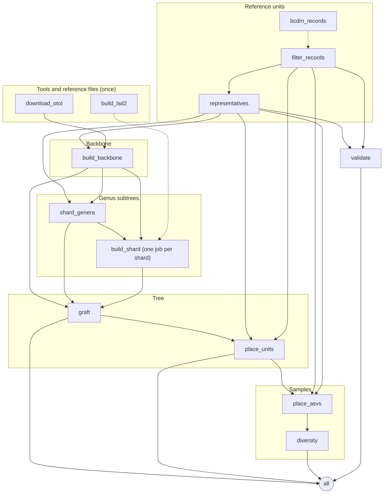

# Running timegraft and its outputs

## Running

```bash
snakemake --cores 4 --use-conda                                   # toy example
snakemake --cores 8 --use-conda --configfile config/config.yaml my_run.yaml
snakemake -n --configfile config/config.yaml my_run.yaml          # dry run: what would be done
```

## Preparing BOLD data

`timegraft.bcdm` also runs on its own, which is the practical way to cut a subset out of a full BOLD data package:

```bash
# 1. which genera occur in the region
python -m timegraft.bcdm BOLD.parquet regional.tsv \
    --taxon phylum=Annelida,Mollusca,Arthropoda,Echinodermata,Cnidaria,Bryozoa,Porifera \
    --exclude class=Insecta,Arachnida,Collembola,Diplopoda,Chilopoda \
    --country Portugal,Spain
cut -f3 regional.tsv | tail -n +2 | grep -v '^$' | sort -u > genera.txt

# 2. all BINs of those genera, worldwide, at most ten records per BIN
python -m timegraft.bcdm BOLD.parquet records.tsv --taxon genus=@genera.txt --max-per-unit 10
```

`rank=@file` reads names from a file, one per line. A list of genera from the samples themselves is a better filter than a country, as a regional BOLD subset also holds terrestrial and freshwater taxa.

## The workflow

Which rules run depends on the configuration: the backbone is either read or built, LSD2 is only built when selected, and placement, diversity and validation only run when their inputs are given. With everything switched on:



Dashed arrows are optional: `bcdm_records` only runs when `bcdm.path` is set, `build_lsd2` only with `dating.method: lsd2`. To draw the graph for your own configuration:

```bash
snakemake --configfile config/config.yaml my_run.yaml --rulegraph mermaid-js
```

## Outputs

All under `outdir`.

| File | Content |
| --- | --- |
| `timegraft.tre` | The dated tree; tips are unit ids |
| `grafted.tre` | The same, before units without a genus were placed |
| `provenance.tsv` | Per backbone genus: subtree, single unit or pruned; stem and crown age; where the crown age came from and the TimeTree value considered; rooting and dating method; outgroup |
| `backbone/genera.tsv` | How each genus was matched in OTT and placed in the synthesis |
| `backbone/node_ages.tsv` | Per backbone node: age, its source, TimeTree's raw answer, the NCBI ids queried, and a conflict ratio |
| `backbone/crown_ages.tsv` | TimeTree crown age estimates, before checking |
| `units/rejected.tsv` | Records rejected by the filter, with the reason |
| `units/representatives.tsv`, `units/unassigned.tsv` | One representative per unit; units without a usable genus |
| `genera/missing_from_backbone.tsv` | Genera with units that are not in the backbone |
| `units_placed.tsv` | What happened to each unit without a genus |
| `placement/placements.tsv` | Per ASV: matched, placed or unplaced, with unit, identity and attachment age |
| `placement/timegraft_placed.tre` | The tree with placed ASVs added |
| `diversity/alpha.tsv` | Per sample: richness, Faith's PD, MPD (presence and abundance-weighted), in Ma |
| `diversity/beta.tsv` | Per pair of samples: unweighted and weighted UniFrac, PhyloSor |
| `diversity/units_not_in_tree.tsv` | Sample units not in the tree |
| `validation/` | Sampled pairs, correlations per stratum, binned medians, plateau onset, `saturation.png` |
| `logs/` | One log per job, with counts of what was kept and why |

## Run times

The first real run (102,794 records, 1,232 genera, 25,578 BINs; the largest genus has 1,035 BINs) took 20 to 28 minutes on 2 cores: about 5 minutes for representatives, 10 for the backbone on a first run (mostly TimeTree; later runs use the cache) and 13 for the genus subtrees with MAFFT.

## Rooting diagnostics

After a run, `timegraft.rooting_diagnostics` rebuilds every genus tree from the run's outputs and reports why outgroup rooting failed and how much the fallback changes ([#19](https://github.com/naturalis/timegraft/issues/19)):

```bash
python -m timegraft.rooting_diagnostics --configfile config/config.yaml my_run.yaml --threads 8
```

It writes `diagnostics/rooting/per_genus.tsv` and `report.md` under the run's `outdir`. Use `--no-variants` to skip re-running the failed genera with other outgroups and a gamma-corrected distance, and `--genera` to look at a few genera only.
